# Crankshaft torsional root-cause study - summary

> **All inputs tagged `# EST` in `inputs.py` are estimates.** Numbers below show the method and the mechanism, not your engine, until the real data is in.

## Model
- Chain nodes: nose, throw1, throw2, flywheel; modes [Hz]: 0, 1000, 2074, 3343
- Tunable stiffness scaled x1.362 to match FE 1000.0 Hz; modal damping zeta = 0.015
- Failure section throw 2 - flywheel: D 38.0 mm, d 0.0 mm, Kt 1.6; tau_W 300.0 MPa

## Resonance crossings inside the operating range (sorted by section stress)
| mode | f [Hz] | order | rpm | stress of that order [MPa] | rel. modal excitation |
|---|---|---|---|---|---|
| 1 | 1000 | 3 | 20000 | 434.5 | 0.46 |
| 1 | 1000 | 4 | 15000 | 163.7 | 0.77 |
| 1 | 1000 | 3.5 | 17143 | 142.7 | 0.46 |
| 1 | 1000 | 4.5 | 13333 | 122.9 | 0.56 |
| 1 | 1000 | 5.5 | 10909 | 90.5 | 0.65 |
| 1 | 1000 | 6.5 | 9231 | 72.3 | 0.72 |
| 1 | 1000 | 6 | 10000 | 59.8 | 0.50 |
| 1 | 1000 | 5 | 12000 | 59.3 | 0.34 |
| 2 | 2074 | 6.5 | 19145 | 38.2 | - |
| 2 | 2074 | 7.5 | 16592 | 28.4 | - |

## Key findings (baseline)
- Peak alternating shear in operating range: **594 MPa at 20000 rpm** (mean 19 MPa); dominant order there: **3**; dominant mode: **1** (569 MPa of it)
- Order 3 relative modal excitation of mode 1: 0.46 (rank 8 of 12 orders up to 6)
- At the order-3 crossing (20000 rpm) one cylinder's order-3 torque: gas 38 Nm, mass 142 Nm, phase difference -170 deg -> they partly CANCEL (overrun / part load is worse!)
- Predicted life with duty cycle: **4.73 h** vs observed 15.0 h (ratio 0.32)
- Damage concentrated at: 20000 rpm (89 %), 19500 rpm (8 %), 19000 rpm (2 %)

## Counterfactuals
| case | peak tau_a in op. range [MPa] | at rpm | life [h] | life / baseline |
|---|---|---|---|---|
| baseline | 594 | 20000 | 4.73 | 1 |
| no order-3 mass torque | 324 | 20000 | 345 | 72.8 |
| no order-3 gas torque | 746 | 20000 | 0.732 | 0.155 |
| no order 3 at all | 246 | 17200 | 717 | 152 |
| order 3 only | 435 | 20000 | 23 | 4.85 |
| overrun approx. (gas torque off) | 766 | 20000 | 0.577 | 0.122 |
| mode +10 % | 274 | 18900 | 371 | 78.3 |
| mode -10 % | 442 | 18000 | 1.15 | 0.242 |
| damping x2 | 381 | 20000 | 101 | 21.3 |
| firing order B | 633 | 20000 | 3.67 | 0.774 |
| with primary drive + driveline | 514 | 19050 | 0.868 | 0.183 |

**Reading the table:** if removing order 3 (or detuning the mode) raises the life by orders of magnitude while the other cases do not, the order-3 / mode-1 resonance is the cause. If 'no order 3 at all' barely helps, another crossing (see the crossing table / fig 08) is doing the damage.

## Figures
- 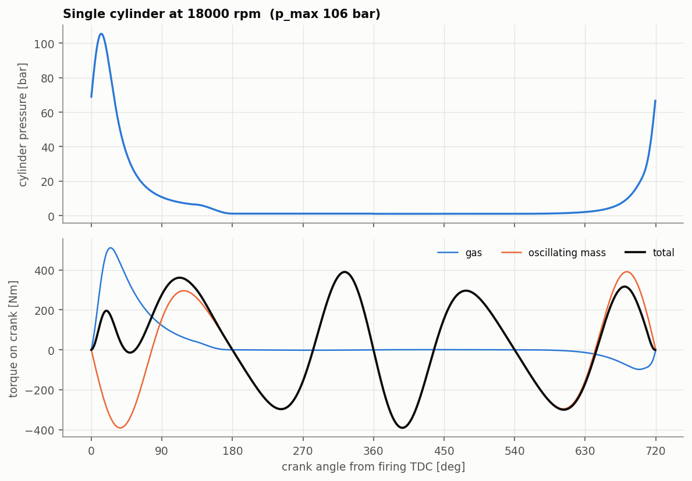
- 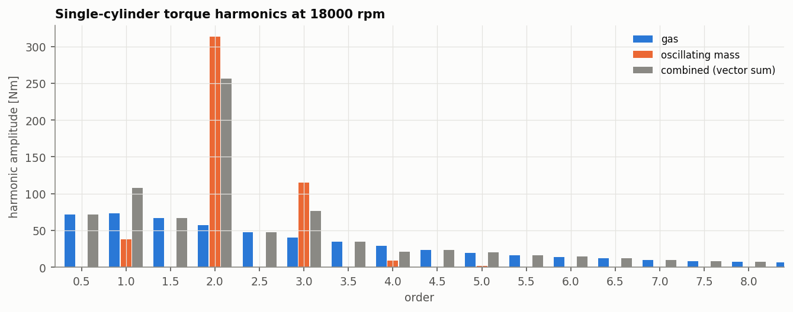
- 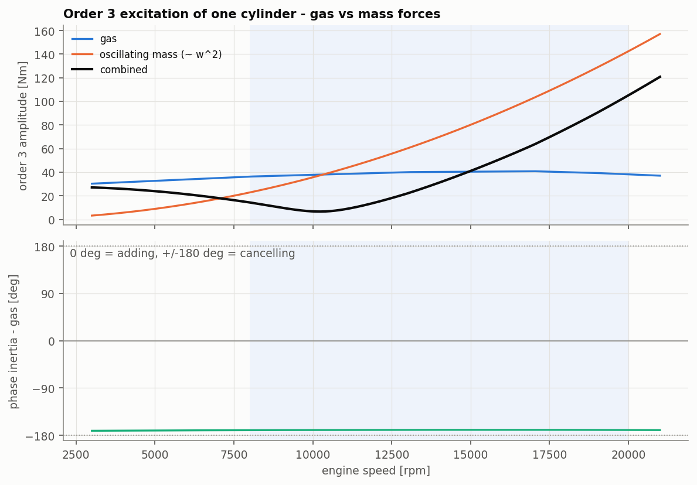
- 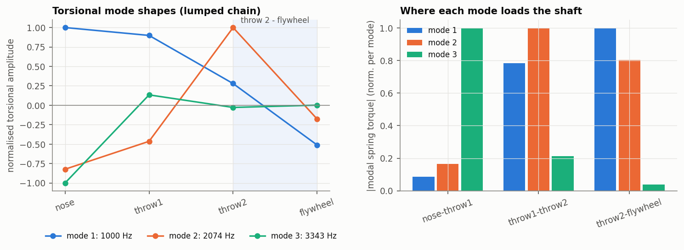
- 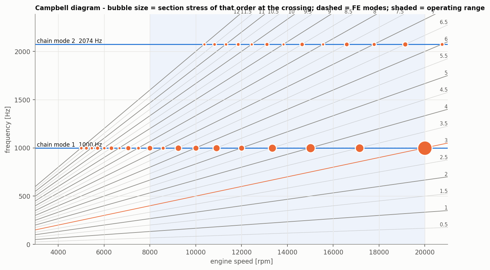
- 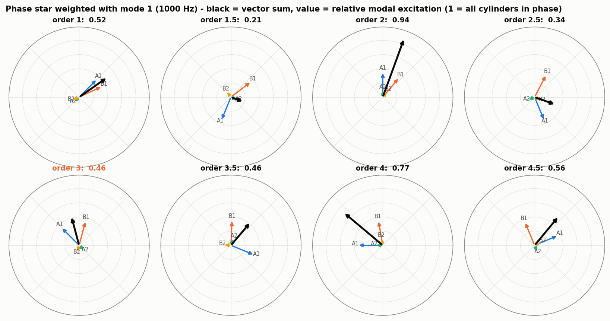
- 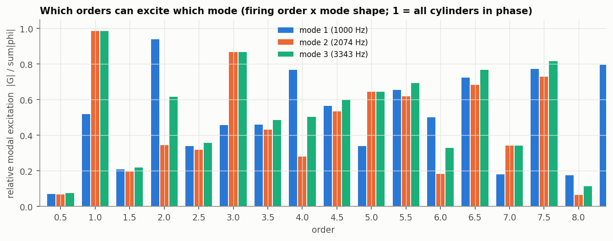
- 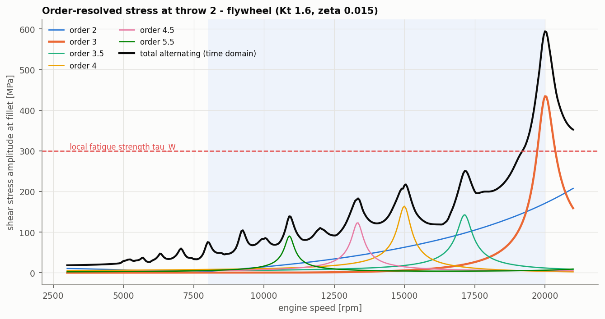
- 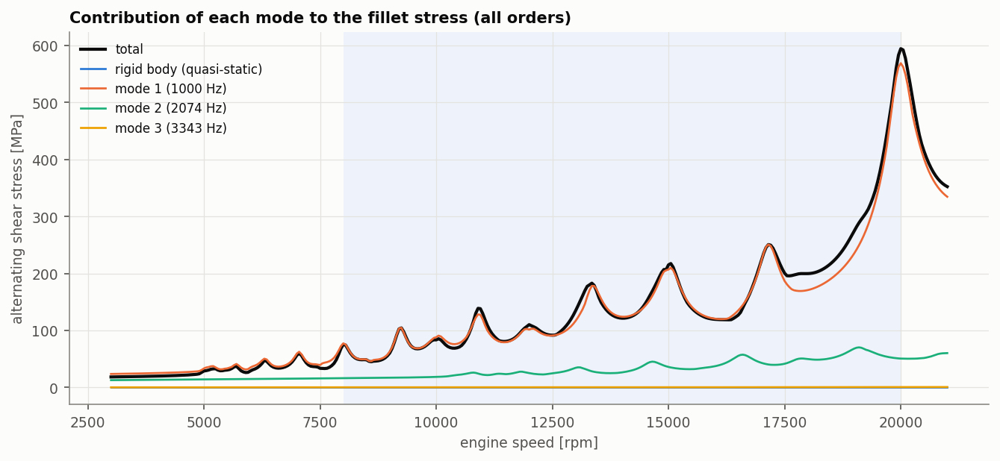
- 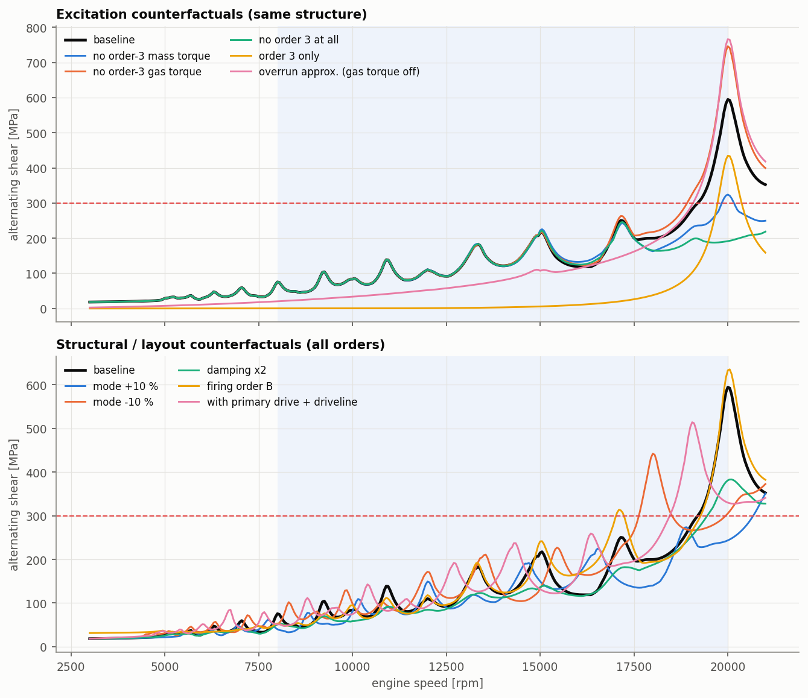
- 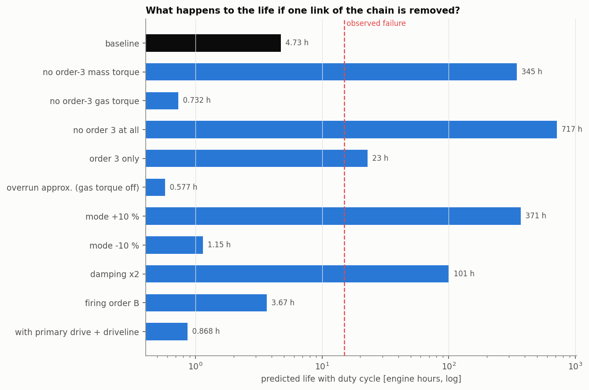
- 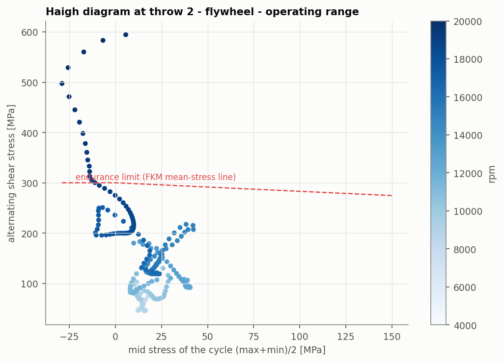
- 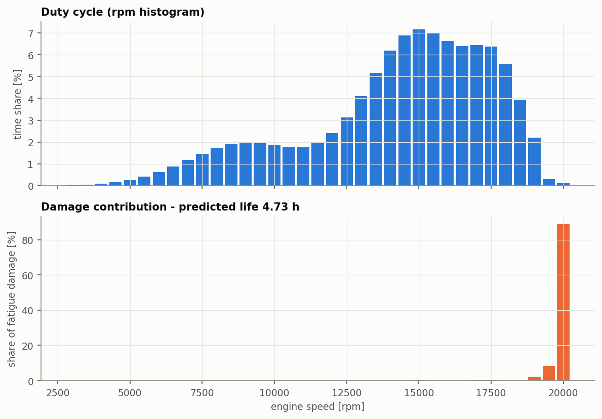